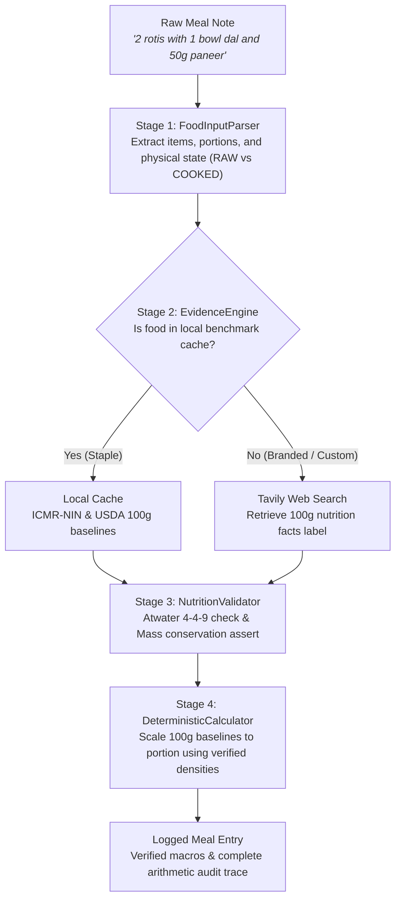

# Nappy Food Journal

A lightweight Android food journal built in Kotlin and Jetpack Compose that uses Gemini to parse natural language meal notes, with strict deterministic arithmetic and Atwater energy checks to prevent AI hallucinations.

Most AI calorie trackers just ask an LLM: *"How many calories are in this meal?"* and trust whatever number it spits out. LLMs are notoriously bad at arithmetic and invent macros out of thin air. Nappy decouples the pipeline: Gemini is used strictly for entity extraction, while all macro math and physical checks happen deterministically in code.

---

## How It Works (The 4-Stage Pipeline)

When you type something like `"2 rotis with 1 bowl dal and 50g paneer"`:



### 1. Entity Extraction (`FoodInputParser.kt`)
- Sends the raw text to Gemini Flash with a constrained JSON schema.
- **Rule #1: Zero AI math.** Gemini is forbidden from calculating calories. It only extracts:
  - Food name (canonicalized)
  - Numeric quantity & unit
  - Physical state (`RAW`, `DRY`, or `COOKED`) — because 100g raw rice (~360 kcal) is vastly different from 100g cooked rice (~130 kcal).
  - Automatically accounts for 5g cooking oil if a dish was cooked as a sabji/curry.

### 2. Evidence Engine (`EvidenceEngine.kt`)
- **Local Cache First:** Standard Indian and global staples (roti, dal, boiled egg, rice, chicken breast, soya chunks, paneer) are resolved locally from ICMR-NIN and USDA 100g baselines with zero API latency.
- **Web Fallback:** For unlisted or branded foods (e.g., *"Nutrela Soya Granules"*), it queries the Tavily Search API for the official nutrition label and cites the source domain.

### 3. Physical Sanity & Atwater Check (`NutritionValidator.kt`)
Before any data is accepted or saved, it must pass physical biological laws:
1. **Mass Conservation:** $\text{Protein} + \text{Carbs} + \text{Fat} \le \text{Total Food Weight} \times 1.05$. (100g of food cannot have 120g of macros).
2. **Atwater 4-4-9 Check:**
   $$\text{Expected Calories} = (4 \times \text{Protein}) + (4 \times \text{Carbs}) + (9 \times \text{Fat})$$
   If the reported calories deviate by more than **20%** from the physical energy density, it flags a warning. (20% tolerance accounts for dietary fiber and FDA/FSSAI regulatory rounding).

### 4. Deterministic Scaling (`DeterministicCalculator.kt`)
- All unit conversions (scoops, bowls, pieces, grams, ml) use verified food density maps ($g/mL$).
- Scales from the 100g benchmark to the exact portion size using deterministic arithmetic in Kotlin.
- Logs an explicit arithmetic trace for every single calculated item.

---

## Tech Stack

- **OS / Platform**: Android (Min SDK 26, Target SDK 35)
- **Language**: Kotlin 2.0
- **UI**: Jetpack Compose + Material 3
- **Networking**: OkHttp 4, Gson
- **LLM / APIs**: Google Gemini API (`gemini-2.5-flash`), Tavily Search API
- **Build**: Gradle Kotlin DSL (`build.gradle.kts`)

---

## Setup & Running

1. **Clone the repo:**
   ```bash
   git clone https://github.com/pixelsmoothie/nappy-food-journal.git
   cd nappy-food-journal
   ```

2. **Add API keys:**
   Create a `local.properties` file in the root directory:
   ```properties
   sdk.dir=/path/to/Android/Sdk
   gemini_api_key=your_gemini_api_key_here
   tavily_api_key=your_tavily_api_key_here # optional for web search
   ```

3. **Build:**
   Open in Android Studio or compile via CLI:
   ```bash
   ./gradlew assembleDebug
   ```

4. **Run Unit Tests:**
   ```bash
   ./gradlew test
   ```
